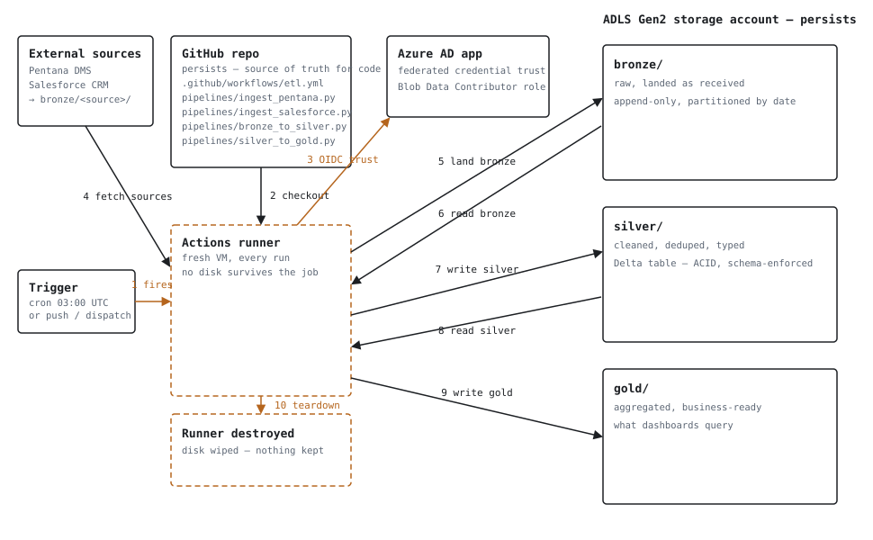

# GitLake

A medallion-architecture lakehouse driven by GitHub Actions: code and orchestration live in this repo, data lives in Azure Data Lake Storage Gen2 as Delta tables, moving bronze → silver → gold on a schedule.



Each run: the Actions runner checks out this repo, trades a GitHub OIDC token for Azure access (no stored secret), reads bronze, writes silver, reads silver back, writes gold — then the VM is destroyed. Only this repo and the storage account persist between runs.

## Layout

```
.github/workflows/etl.yml      # schedule + job steps
pipelines/bronze_to_silver.py  # clean/dedupe raw bronze into silver
pipelines/silver_to_gold.py    # aggregate silver into gold
requirements.txt
docs/architecture.svg
```

Data itself is **not** in this repo — it lives in ADLS Gen2, as Delta tables under three containers/paths:

- `bronze/` — raw data, landed as received, append-only
- `silver/` — cleaned, deduped, typed
- `gold/` — aggregated, business-ready tables your dashboards query

## Setup

1. **Storage account** — create an ADLS Gen2 account (hierarchical namespace enabled) with containers `bronze`, `silver`, `gold`.

2. **Azure AD app registration** — create an app registration and add a federated credential that trusts GitHub's OIDC tokens for this repo:
   - Issuer: `https://token.actions.githubusercontent.com`
   - Subject: `repo:tiger13tiger/gitlake:ref:refs/heads/main` (adjust branch as needed; use `:environment:<name>` instead if you deploy via a GitHub Environment)

3. **Role assignment** — grant that app's service principal the **Storage Blob Data Contributor** role, scoped to the storage account.

4. **Repo configuration**:
   - Secrets: `AZURE_CLIENT_ID`, `AZURE_TENANT_ID`, `AZURE_SUBSCRIPTION_ID`
   - Variable: `ADLS_ACCOUNT_NAME` (the storage account name — not sensitive, so it's a variable, not a secret)

5. Push to `main` or run the `medallion-etl` workflow manually (`workflow_dispatch`) to trigger the first run.

## Notes

- `pipelines/*.py` use `pandas` + `deltalake` (delta-rs) rather than PySpark — lighter to install on a GitHub-hosted runner, no JVM startup cost. Swap in PySpark if a stage needs real distributed compute.
- The sample transforms (`sales` bronze → silver → gold) are placeholders — replace the read path, cleaning rules, and aggregation with your actual source and business logic.
- Runners are stateless between runs: don't rely on anything written to local disk surviving past the job that wrote it.
